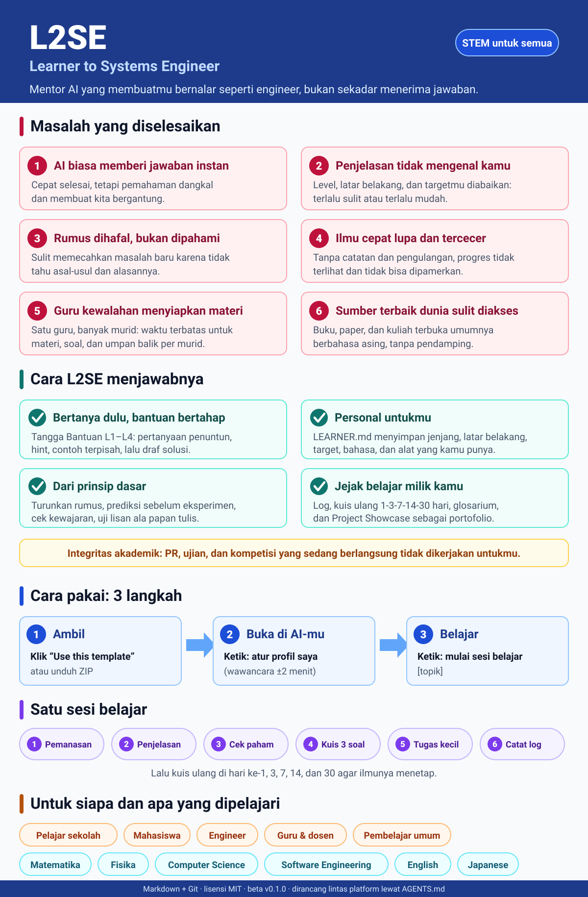

# L2SE — Learner to Systems Engineer

[](https://github.com/Raguna633/l2se/actions/workflows/check-docs.yml) [](LICENSE) 

**Mentor AI untuk belajar STEM dari prinsip dasar, menuju cara berpikir seorang *engineer*.**
*An AI mentor framework for learning STEM from first principles.* — 🌐 **[English Overview (`README.en.md`)](README.en.md)**

> **Status: beta (`v0.2.0`).** Struktur dan aturan sudah dapat dipakai, tetapi belum diuji luas oleh banyak pengguna. Masukan sangat diharapkan lewat [Issues](https://github.com/Raguna633/l2se/issues).

**L2SE** (dibaca "el-tu-es-i", kependekan dari ***Learner to Systems Engineer***) adalah *framework* terbuka berbasis Markdown + Git yang mengubah AI agent favorit Anda (Claude, ChatGPT, Gemini, Cursor, Copilot, Antigravity, dan lainnya) menjadi **mentor STEM pribadi**. Mentor ini tidak memberi jawaban instan. Ia membimbing Anda bernalar dari prinsip dasar, memecahkan masalah, bereksperimen, dan merancang, seperti seorang *engineer*.

**Visi:** Setiap orang, di mana pun, bisa bernalar seperti *engineer*: memahami dari prinsip dasar, bukan menghafal.

**Misi:**
1. **Mengutamakan pemahaman.** Mentor bertanya dulu, memberi bantuan bertingkat (Tangga Bantuan), dan menjaga integritas akademik.
2. **STEM untuk semua kalangan.** Pelajar sekolah, mahasiswa, *engineer*, guru, maupun pembelajar umum mendapat bimbingan sesuai jenjang dan konteksnya.
3. **Belajar lewat karya.** Teori diikat ke eksperimen, simulasi, dan proyek nyata yang menjadi portofolio.
4. **Bahasa sebagai gerbang dunia.** Membantu pelajar mengakses buku, paper, dan kuliah terbuka terbaik dunia.
5. **Terbuka dan milik pengguna.** Cukup Markdown + Git, lintas platform, dan dapat dikembangkan bersama komunitas.



Alur lengkap dari pemasangan sampai belajar jangka panjang (dengan diagram *flowchart*) ada di **[docs/cara-kerja.md](docs/cara-kerja.md)**.

---

## ✨ Apa yang Membuatnya Berbeda?

| Fitur | Artinya bagi Anda |
|---|---|
| **Prinsip dasar, bukan hafalan** | Mentor mengajak Anda memahami *kenapa* sebuah rumus ada, lalu menurunkannya, bukan sekadar memasukkan angka. Lihat [Protokol STEM](docs/stem-pedagogy.md). |
| **Ujian papan tulis** | Latihan menjelaskan dan merancang dari nol (`"uji lisan [topik]"`), lengkap dengan rubrik. |
| **Pendamping kuliah terbuka** | Belajar dari kuliah universitas dunia dengan pembimbing yang mengecek pemahaman Anda (`"dampingi kuliah [judul/URL]"`). |
| **Personalisasi lewat `LEARNER.md`** | Bahasa, jenjang matematika, analogi, target ujian/olimpiade/beasiswa, dan alat yang Anda punya ikut diperhitungkan. |
| **Tangga Bantuan L1–L4 & integritas akademik** | Bantuan naik bertahap, dan PR/ujian tidak dikerjakan untuk Anda. |
| **Jejak belajar milik Anda** | Log, glosarium, dan karya tersimpan sebagai berkas Markdown yang bisa dipamerkan. |
| **Lintas platform** | Satu sumber aturan ([AGENTS.md](AGENTS.md)) untuk banyak AI agent. Lihat [status kompatibilitas](docs/platform-compatibility.md). |

---

## 🚀 Mulai dalam 3 Langkah

Panduan lengkap per jalur dan per peran ada di **[docs/getting-started.md](docs/getting-started.md)**.

### Jalur A — Tanpa Koding (pelajar, guru, pembelajar umum)
1. Klik **Code → Download ZIP** di halaman GitHub ini, lalu ekstrak.
2. Buat *Project* di Claude atau ChatGPT (atau *Gem* di Gemini). Tempel isi [AGENTS.md](AGENTS.md) sebagai instruksi (bila kolom instruksi terlalu pendek, ikuti [cara alternatif](docs/getting-started.md#jalur-a--tanpa-koding-lewat-aplikasi-chat)), lalu unggah [docs/stem-pedagogy.md](docs/stem-pedagogy.md), [templates/template-learner.md](templates/template-learner.md), dan berkas topik sesuai [daftar unggahan per topik](docs/getting-started.md#daftar-berkas-yang-diunggah-per-topik).
3. Ketik `"atur profil saya"`, lalu `"mulai sesi belajar [topik]"`.

> **Batas usia:** setiap platform AI punya batas usia minimum dan aturan izin orang tua. Pelajar sekolah sebaiknya memeriksa syarat layanan platform yang dipakai dan belajar dengan pendampingan orang tua atau guru bila diperlukan.

### Jalur B — Dengan AI IDE / Agent (Claude Code, Cursor, Copilot, Antigravity, dsb.)
1. Klik **Use this template** untuk membuat repositori Anda sendiri (boleh privat), lalu *clone* ke komputer.
2. Buka folder *root* repositori di AI IDE Anda.
3. Ketik `"atur profil saya"`. Mentor akan mewawancarai Anda dan membuat `LEARNER.md`.

### Jalur C — Developer (ingin mengikuti pembaruan *framework*)
```bash
git clone https://github.com/Raguna633/l2se.git my-learning
cd my-learning
git remote rename origin upstream
git remote add origin https://github.com/<username-anda>/my-learning.git
```
Cara menarik pembaruan tanpa konflik ada di [docs/updating.md](docs/updating.md).

---

## 💬 Seperti Apa Rasanya?

> **Pelajar:** Tolong kerjakan PR fisika saya: balok 2 kg ditarik 10 N di lantai licin, berapa percepatannya?
>
> **Mentor:** Karena ini PR, aku tidak akan menuliskan jawabannya, tapi aku bantu sampai kamu bisa sendiri. Kalau kamu mendorong troli kosong dan troli penuh dengan tenaga yang sama, mana yang lebih cepat bertambah lajunya?
>
> **Pelajar:** Yang kosong.
>
> **Mentor:** Tepat. Jadi percepatan bergantung pada gaya dan massa. Hukum mana yang menghubungkan ketiganya?

Contoh lengkap (termasuk ujian lisan dan sesi untuk guru) ada di [docs/examples/contoh-sesi.md](docs/examples/contoh-sesi.md).

---

## ⌨️ Perintah Pemicu Cepat (*Command Shortcuts*)

Ketik perintah ini di *chat* kapan saja. Perilaku persisnya ada di bagian **Standar Perintah Pemicu Cepat** di [AGENTS.md](AGENTS.md).

| Perintah | Fungsi |
|---|---|
| `"atur profil saya"` / `"perbarui profil"` | Wawancara singkat untuk membuat atau memperbarui `LEARNER.md`. |
| `"mulai sesi belajar [topik]"` | Sesi terstruktur: pemanasan → penjelasan & analogi → cek pemahaman → kuis 3 soal → tugas → log. |
| `"turunkan [rumus/konsep]"` | Menurunkan rumus dari prinsip dasar, langkah demi langkah. |
| `"uji lisan [topik/sistem]"` | Simulasi ujian papan tulis: rancang atau jelaskan dari nol, dinilai dengan rubrik. |
| `"uji saya tanpa bantuan [topik]"` | Ujian mandiri tanpa *hint*, skor 0–5 dan analisis celah pemahaman. |
| `"kuis ulang"` | *Spaced repetition* dari `notes/learning-log.md`. |
| `"dampingi kuliah [judul/URL]"` | Pendamping kuliah terbuka: pertanyaan pemantik, cek pemahaman, glosarium. |
| `"baca bersama [teks/paper/bab]"` | Membaca teks STEM berbahasa asing bersama mentor. |
| `"jelajah frontier [bidang]"` | Menghubungkan topik dengan teknologi, riset, dan tokoh terkini. |
| `"review kode ini"` / `"review karya ini"` / `"bantu lab [nama]"` | Umpan balik bertahap atas kode, laporan, atau proyek. |
| `"ulasan mingguan"` / `"tinjau parkir"` | Evaluasi mingguan dan peninjauan topik yang ditunda (`[PARKIR]`). |
| `"catat log"` / `"catatan keputusan"` | Menyimpan ringkasan sesi atau catatan keputusan desain. |
| `"buat topik baru [nama]"` / `"sesuaikan topik [nama]"` | Membuat topik baru, atau menyesuaikan topik bawaan dengan profil Anda. |
| `"rancang materi ajar [topik]"` / `"buat bank soal [topik]"` | Khusus guru/dosen: rencana pembelajaran dan soal terbuka beserta rubrik. |

---

## 📚 Topik Saat Ini

Topik berikut adalah **paket topik bawaan**. Sesuaikan dengan `"sesuaikan topik [nama]"`, hapus yang tidak diperlukan, atau tambahkan topik baru dengan `"buat topik baru [nama]"`.

| Kategori | Topik | Tautan | Panduan Mentor Khusus |
|---|---|---|---|
| **M** — Mathematics | Matematika (sekolah → universitas → rekayasa) | [README](mathematics/foundations/README.md) · [Roadmap](mathematics/foundations/roadmap.md) · [Log](mathematics/foundations/notes/learning-log.md) · [Glosarium](mathematics/foundations/notes/glossary.md) | [Bagian 1](mathematics/foundations/rules.md) · [Bagian 2](mathematics/foundations/rules-misconceptions-and-assessment.md) |
| **S** — Science | Fisika (sekolah → universitas → rekayasa) | [README](science/physics/README.md) · [Roadmap](science/physics/roadmap.md) · [Log](science/physics/notes/learning-log.md) · [Glosarium](science/physics/notes/glossary.md) | [Bagian 1](science/physics/rules.md) · [Bagian 2](science/physics/rules-misconceptions-and-experiments.md) |
| **T** — Technology | Computer Science (9 subjek & *low-level*) | [README](technology/computer-science/README.md) · [Roadmap](technology/computer-science/roadmap.md) · [Log](technology/computer-science/notes/learning-log.md) · [Glosarium](technology/computer-science/notes/glossary.md) | [CS Tutor](technology/computer-science/tutor/SKILL.md) |
| **E** — Engineering | Software: Backend (Go) | [README](engineering/software/go/README.md) · [Log](engineering/software/go/notes/learning-log.md) · [Glosarium](engineering/software/go/notes/glossary.md) | [Bagian 1](engineering/software/go/rules.md) · [Bagian 2](engineering/software/go/rules-concepts-and-antipatterns.md) |
| **E** — Engineering | Software: Frontend (React & TypeScript) | [README](engineering/software/react/README.md) · [Log](engineering/software/react/notes/learning-log.md) · [Glosarium](engineering/software/react/notes/glossary.md) | [Bagian 1](engineering/software/react/rules.md) · [Bagian 2](engineering/software/react/rules-patterns-and-architecture.md) |
| **E** — Engineering | Software: Mobile Web UI/UX | [README](engineering/software/ui-ux-mobile/README.md) · [Log](engineering/software/ui-ux-mobile/notes/learning-log.md) · [Glosarium](engineering/software/ui-ux-mobile/notes/glossary.md) | [Rules](engineering/software/ui-ux-mobile/rules.md) |
| Bahasa | English for STEM | [README](languages/english/README.md) · [Roadmap](languages/english/roadmap.md) · [Log](languages/english/notes/learning-log.md) · [Glosarium](languages/english/notes/glossary.md) | Mengikuti [AGENTS.md](AGENTS.md) |
| Bahasa | Japanese for STEM (mis. persiapan beasiswa MEXT) | [README](languages/japanese/README.md) · [Roadmap](languages/japanese/roadmap.md) · [Log](languages/japanese/notes/learning-log.md) · [Glosarium](languages/japanese/notes/glossary.md) | Pedoman mentor di [README](languages/japanese/README.md) |

Cabang rekayasa lain (elektro, mesin, sipil, kimia) dan sains lain (kimia, biologi) dapat ditambahkan dengan struktur yang sama. Lihat [CONTRIBUTING.md](CONTRIBUTING.md).

---

## 🗂️ Struktur Repositori

```text
.
├── AGENTS.md          # Aturan inti AI Mentor (sumber kebenaran untuk semua platform)
├── CLAUDE.md          # Jembatan Claude Code → AGENTS.md
├── LEARNER.md         # Profil Anda (dibuat lewat "atur profil saya"; tidak disertakan di framework)
├── docs/              # Cara kerja (flowchart), Protokol STEM, panduan memulai, kompatibilitas, pembaruan, FAQ, contoh
├── templates/         # Template profil, topik, log, glosarium, dan catatan keputusan
├── mathematics/       # M — Matematika
├── science/           # S — Fisika, kimia, biologi, ...
├── technology/        # T — Ilmu komputer
├── engineering/       # E — Cabang rekayasa (software/, dan cabang lain)
├── languages/         # Bahasa sebagai gerbang STEM
│   └── <topik>/
│       ├── README.md          # [WAJIB] Target, silabus, sumber, Project Showcase
│       ├── notes/             # [WAJIB] learning-log.md, glossary.md
│       ├── projects/          # [KONTEKSTUAL] Eksperimen, simulasi, proyek (diabaikan Git secara default)
│       └── rules.md / tutor/  # [OPSIONAL] Panduan mentor khusus topik
└── .agents/           # Pendaftaran skill untuk Antigravity
```

**Istilah singkat.** *Root* = folder paling atas repositori ini. *Markdown* (`.md`) = berkas teks biasa yang bisa dibuka dengan Notepad. *Clone* = menyalin repositori ke komputer lewat Git. *Project/Gem* = fitur ruang kerja di Claude, ChatGPT, dan Gemini yang menyimpan instruksi dan berkas.

**Zona Framework vs Zona Pengguna.** Berkas aturan (`AGENTS.md`, `templates/`, `docs/`, `rules*.md`, `SKILL.md`) adalah milik *framework*. `LEARNER.md`, isi `notes/`, `projects/`, dan topik baru adalah milik Anda. Pemisahan ini membuat pembaruan *framework* minim konflik.

---

## 🛡️ Proyek, Privasi & Keamanan

- **Proyek besar di repositori terpisah.** Folder `projects/*` diabaikan Git (lihat [.gitignore](.gitignore)). Simpan proyek nyata sebagai repositori mandiri di dalam `projects/` agar mentor tetap bisa membacanya secara lokal, lalu tautkan di tabel *Project Showcase* pada README topik. Untuk melacak mini-lab kecil, gunakan `git add -f <path>`.
- **Keselamatan eksperimen.** Mentor diinstruksikan menyebut risiko dan alat pelindung, serta menyarankan pendampingan guru atau orang dewasa bagi pelajar sekolah.
- **Profil Anda, pilihan Anda.** Secara bawaan `LEARNER.md` dan cadangan lokal `.l2se-backup/` diabaikan di [.gitignore](.gitignore) agar privasi Anda tidak bocor saat memakai repositori publik. Jika ingin melacak `LEARNER.md` di repo pribadi, jalankan `git add -f LEARNER.md` (jangan menulis data sensitif). Mentor juga membuat cadangan profil secara proaktif dan memberi tahu Anda setiap ada pembaruan bermakna.
- **Kredensial.** `.gitignore` memblokir `.env*`, `*.key`, dan `*.pem`. Mentor diinstruksikan untuk tidak pernah meminta atau menampilkan kredensial nyata.

---

## 🗺️ Rencana Berikutnya

- Paket topik **Kimia** dan **Biologi**, lalu cabang rekayasa **Elektro** dan **Mesin**.
- Uji coba oleh pelajar, guru, dan *engineer* sungguhan, lalu perbaikan menuju `v1.0.0`.
- Pengujian di lebih banyak platform AI (lihat [status kompatibilitas](docs/platform-compatibility.md)).

Usulan dan bantuan sangat diterima. Lihat [CONTRIBUTING.md](CONTRIBUTING.md).

---

## 🤝 Kontribusi & Lisensi

- Ingin menambah topik STEM, memperbaiki aturan, atau melaporkan masalah? Baca [CONTRIBUTING.md](CONTRIBUTING.md) dan [CODE_OF_CONDUCT.md](CODE_OF_CONDUCT.md).
- Riwayat perubahan ada di [CHANGELOG.md](CHANGELOG.md).
- Dirilis di bawah [MIT License](LICENSE). Bila memakai L2SE dalam penelitian atau materi ajar, Anda dapat mengutipnya lewat [CITATION.cff](CITATION.cff).
