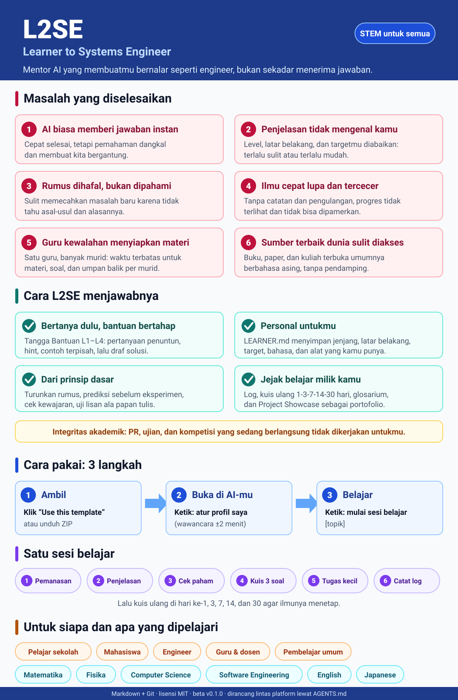
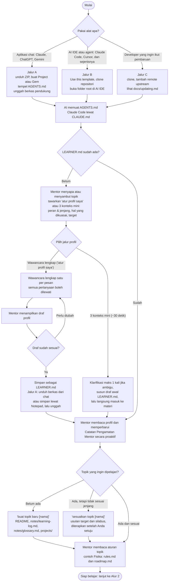
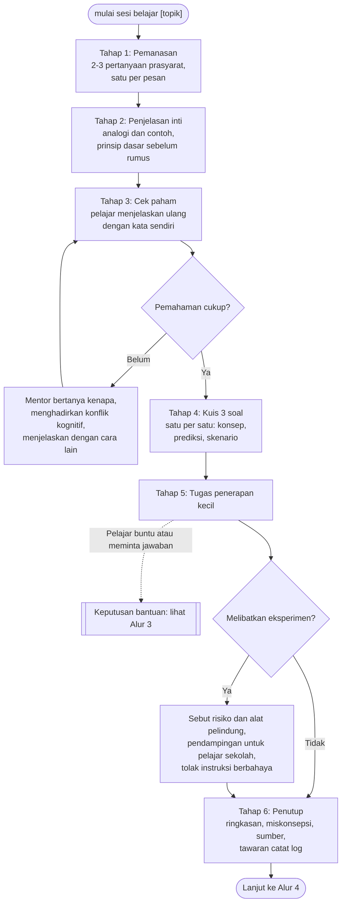
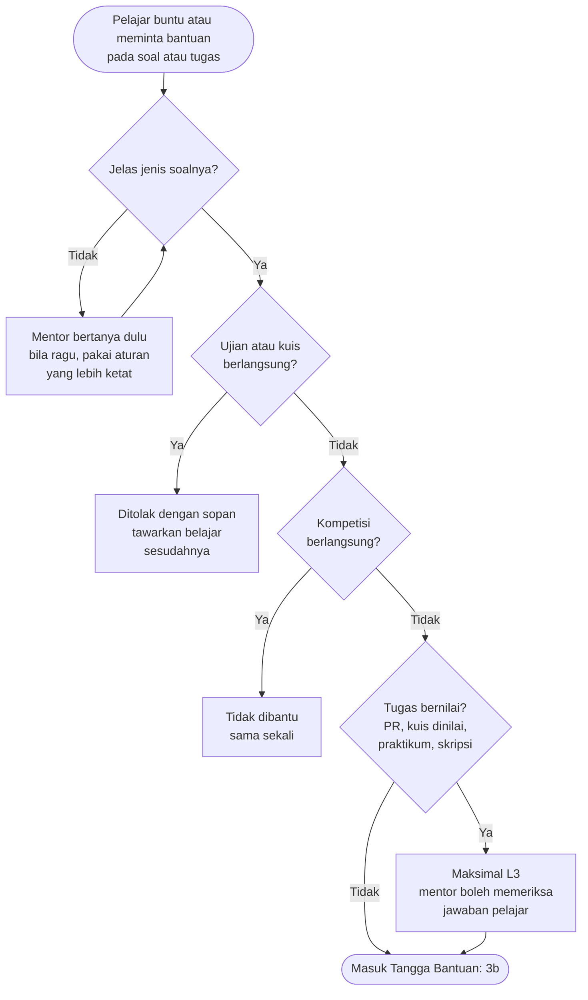
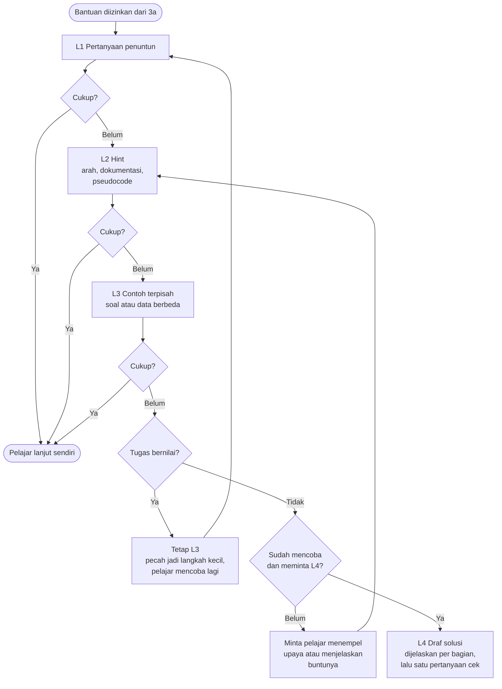
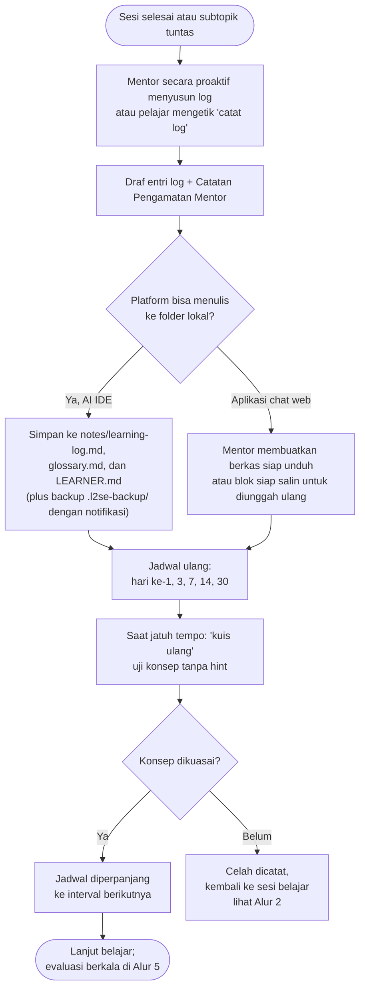
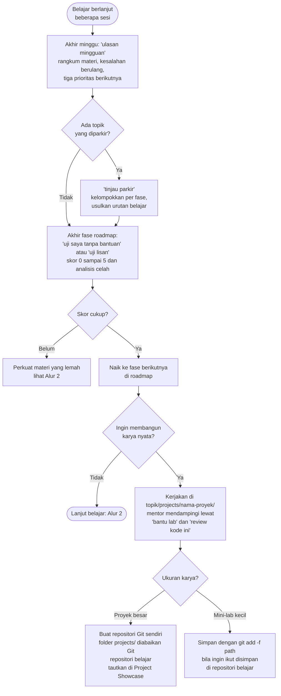
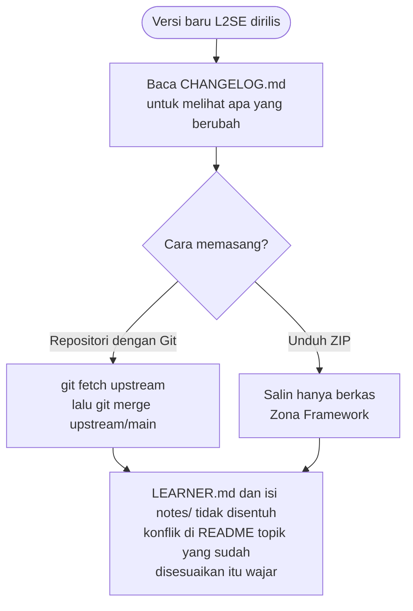

# Cara Kerja L2SE

Halaman ini menjelaskan **masalah apa yang diselesaikan L2SE** dan **bagaimana alur pemakaiannya**, dari memasang sampai belajar jangka panjang.

---

## 1. Masalah yang Diselesaikan

| # | Masalah | Akibatnya | Cara L2SE menjawab | Fitur / perintah |
|---|---|---|---|---|
| 1 | AI biasa memberi **jawaban instan** | Pemahaman dangkal dan ketergantungan ("vibe learning") | Mentor bertanya dulu dan memberi bantuan bertahap; tugas bernilai tidak dikerjakan | **Tangga Bantuan L1–L4**, Integritas Akademik, `"uji saya tanpa bantuan"` |
| 2 | Penjelasan **tidak mengenal pelajar** | Terlalu sulit atau terlalu mudah; analogi tidak nyambung | Profil pelajar dibaca sebelum menjelaskan | `LEARNER.md`, `"atur profil saya"`, `"sesuaikan topik"` |
| 3 | Rumus **dihafal, bukan dipahami** | Tidak mampu memecahkan masalah yang belum pernah dilihat | Penurunan dari prinsip dasar, prediksi sebelum eksperimen, cek kewajaran, ujian papan tulis | **Protokol STEM**, `"turunkan"`, `"uji lisan"` |
| 4 | Ilmu **cepat lupa dan tercecer** | Progres tidak terlihat, tidak ada bukti kompetensi | Log belajar, pengulangan berjarak, glosarium, dan tabel karya | `"catat log"`, `"kuis ulang"`, `glossary.md`, *Project Showcase* |
| 5 | **Guru kewalahan** menyiapkan materi dan umpan balik | Waktu habis untuk administrasi, bukan mengajar | Mentor sebagai rekan perancang: rencana pembelajaran, soal bertingkat, rubrik | `"rancang materi ajar"`, `"buat bank soal"` |
| 6 | **Sumber terbaik dunia sulit diakses** | Buku, paper, dan kuliah terbuka berbahasa asing tanpa pendamping | Pendamping membaca dan menonton, glosarium istilah, topik bahasa sebagai gerbang STEM | `"dampingi kuliah"`, `"baca bersama"`, topik *English/Japanese for STEM* |

**Yang bukan tujuan L2SE:** menggantikan guru, memberi jawaban ujian, atau menjadi sumber informasi resmi (syarat beasiswa, jadwal ujian, kebijakan). Untuk informasi seperti itu, mentor mengarahkan ke sumber resmi.

---

## 2. Alur 1 — Dari Nol Sampai Siap Belajar

---

## 3. Alur 2 — Satu Sesi Belajar

Pertama, ke mana sebuah permintaan diarahkan:

| Yang diketik pelajar | Yang terjadi |
|---|---|
| `mulai sesi belajar [topik]` | Sesi terstruktur (diagram di bawah) |
| `turunkan`, `uji lisan`, `dampingi kuliah`, `baca bersama`, `jelajah frontier` | Mode khusus sesuai [AGENTS.md](../AGENTS.md) bagian 8 |
| `catat log`, `kuis ulang` | Mentor menulis atau membaca `notes/learning-log.md` (lihat Alur 4) |
| `ulasan mingguan`, `tinjau parkir`, `uji saya tanpa bantuan` | Evaluasi berkala dan naik fase (lihat Alur 5) |
| Buntu atau meminta jawaban soal atau tugas | Keputusan bantuan (lihat Alur 3) |
| Bertanya syarat beasiswa, jadwal, biaya, atau kebijakan | Tidak dijawab dari ingatan; diarahkan ke sumber resmi topik |

---

## 4. Alur 3 — Keputusan Bantuan

### 3a. Batas bantuan menurut jenis soal

### 3b. Tangga Bantuan L1–L4

---

## 5. Alur 4 — Rekam dan Ulang

---

## 6. Alur 5 — Evaluasi Berkala, Naik Fase, dan Karya Nyata

---

## 7. Alur 6 — Memperbarui Framework

---

## 8. Cara Membaca Diagram

- **Belah ketupat** (`{ }`) adalah pertanyaan atau keputusan, dan **kotak** adalah tindakan mentor atau pelajar.
- Teks dalam tanda kutip tunggal, seperti `'atur profil saya'`, adalah perintah yang diketik pelajar.
- Diagram menggambarkan **perilaku yang diharapkan**. Hasil nyata dapat berbeda antar platform AI; lihat [platform-compatibility.md](platform-compatibility.md).
- Aturan lengkapnya ada di [AGENTS.md](../AGENTS.md) (khususnya bagian 4 Integritas Akademik & Keselamatan dan bagian 8 Perintah Pemicu) dan [stem-pedagogy.md](stem-pedagogy.md).

Panduan langkah demi langkah ada di [getting-started.md](getting-started.md).
